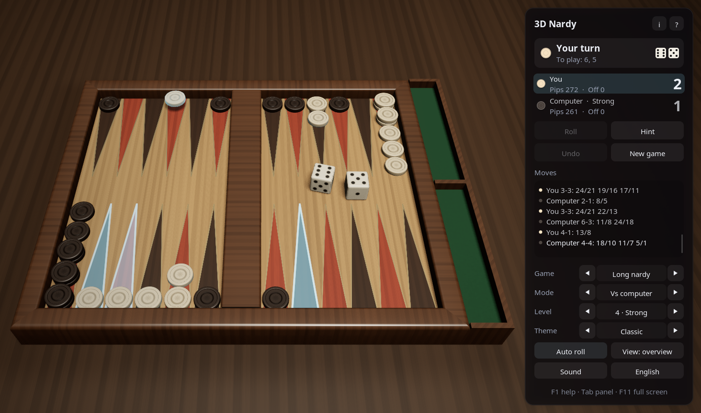
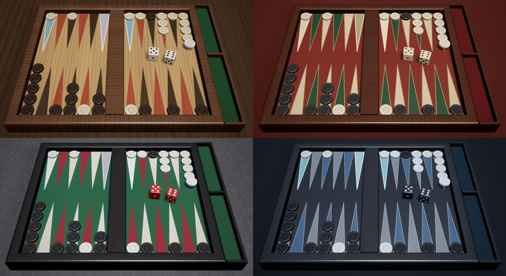

# 3D Nardy — C++23, SDL2 and OpenGL 4.6 for Linux

[](https://github.com/sponsors/makarov-mm)
[](LICENSE)


[](https://www.linkedin.com/in/makarov-mm/)
[](https://www.threads.net/@m.m.makarov)
[](https://www.instagram.com/m.m.makarov/)

A 3D nardy game for Linux written in modern C++ on SDL2 and OpenGL 4.6: long nardy, the game of the Caucasus and Central Asia, and short nardy, known in the West as backgammon. The computer opponent judges positions with small neural networks it taught itself by playing millions of games.

There is no game engine and no model, texture or sound file: the board, the checkers and the dice are built in code at startup, the wood, leather, felt and stone are procedural, the lighting environment is baked on the GPU, and the sounds are synthesized. The only libraries are the ones every Linux desktop has: SDL2 for the window, the input and the sound, FreeType and fontconfig for the text, libpng for the icon. The shaders, the networks and the icon are built into the executable, so the game is a single file.





## Features

### Games

- **Long nardy** (длинные нарды): fifteen checkers each on the «head», both sides running the same way round the board. A single checker holds a point; only one checker may leave the head a turn, two on a first roll of 6-6, 4-4 or 3-3; no six points in a row may be held unless an opponent's checker is already past them. A win is one point, two for a mars, when the opponent has borne off none
- **Short nardy** (короткие нарды, backgammon): the sides run against each other, a lone checker is hit to the bar and must enter the opponent's home before anything else moves. A win is one point, two for a mars (gammon), three for a koks (backgammon)
- Both: a double is played four times, both dice must be played when they can be, the higher one when only one can, and the checkers are borne off once all fifteen are home
- The players throw a die each to see who starts; in short nardy those two dice are the first roll

### The computer player

- Judges every way of playing a roll by the position it leaves: a network of 200 inputs, 64 hidden units and three outputs, the chances of winning, of winning a mars and of losing one. One network for each game, about 50 KB each
- Taught by temporal-difference learning, as TD-Gammon was: it played against itself over a million games of each kind, nudging its judgement of each position toward that of the next. It beats a sensible greedy player in about 94 games of 100 at short nardy and practically always at long nardy
- Five levels, from Novice to Master. The lower levels misjudge on purpose, Novice by much, and now and then plays a random move; Master also looks a roll ahead: for its eight best moves, every one of the 21 rolls the opponent may answer with and the opponent's best reply
- Thinks on a thread of its own, then plays its steps one by one; the hint is Master's advice
- `tools/Train.cpp` is the program that taught the networks; see [Teaching the networks](#teaching-the-networks)

### Play

- Click a checker, then where it goes, or drag it there; the places it may reach glow, with one die or several in turn by the same checker, and the dice still to play are listed. A double-click plays the higher die
- Only legal steps are offered, and every step leaves a way to play the whole roll by the rules; clicking a checker that may not move says why: a checker on the bar to bring in first, or the head already left this turn
- Take back a step with a right click or `Backspace`, the whole turn with **Undo**, or go back to an earlier turn of yours and play it again with the same dice
- The hint shows the computer's best move on the board and in words; asked for again, it plays it
- The dice thrown with `Space`, a click on the board, the button, or by themselves
- Play against the computer, two players on one computer, or watch a demo game
- The moves in the notation players write: `24/18`, `13/7*` for a hit, `bar/22`, `6/off`, `13/7(2)`; the pips left and the checkers borne off; the score over the games
- The game in progress, its history, the settings and the window's size kept between sessions
- Two views: an overview from White's side and one from above. The camera also turns with the right mouse button and zooms with the wheel
- English and Russian interface, chosen from the system language
- An about card with the author and links to his pages, which open in the browser
- Sounds mixed on the audio device's own thread: dice shaken and bouncing, checkers set down, knocked off and dropped into the tray
- Full screen; the interface follows the desktop's scaling (X11's `Xft.dpi`, as Cinnamon, GNOME, KDE and Xfce set it, or the output scale on Wayland)
- Shortcuts work in any keyboard layout: by their letters in Latin layouts, by their places in others, such as the Russian one
- No work while nothing moves: the game waits for input instead of drawing the same picture

### Graphics

- Physically based shading: GGX highlights, a clear coat on the checkers, the dice and the box, image-based lighting from a procedural room with a lamp over the board
- Soft shadows (PCSS); HDR rendering with 4× MSAA, bloom, ACES tone mapping and vignette
- A board of two fields with the points inlaid and edged with a thin line, drawn by the shader and filtered over each pixel; mitred rims, the middle bar, and a tray beside it where the checkers borne off stand on edge
- Checkers turned of wood, stone, bone or plastic, with a raised rim, a carved groove and a rosette; dice with rounded edges and sunken pips
- Animation: the dice thrown across the board, bouncing and tumbling to rest on the numbers rolled and darkening as they are played; checkers flying in arcs, lifted when chosen, a lone one knocked off to the bar, borne off ones turning on edge into the tray
- Marks on the board: where the chosen checker may go, which checkers may move, the last move, and the hint
- Four themes: Classic (a light wooden field with dark and red points in a walnut box, ivory and ebony checkers), Oriental (red leather with a gold line, a lacquered box, bone and onyx), Tournament (green felt, black lacquer, red precision dice) and Night (dark leather, slate points and a silver line, pearl and black stone)
- An interface of frosted-glass panels, sharp at any screen scale

## Controls

| Action | Control |
|---|---|
| Choose a checker, then where it goes | Click |
| Move a checker | Drag it |
| Play the higher die | Double-click the checker |
| Take back a step | Right click, `Backspace` |
| Undo the turn | `Ctrl+Z`, the **Undo** button |
| Roll the dice; end the turn at once | `Space`, `Enter` |
| Hint; again to play it | `H` |
| Roll by itself | `A` |
| Turn the view | Drag with the right mouse button, or on an empty part of the board |
| Zoom | Mouse wheel |
| Next view; reset it | `C`; `Home` |
| New game | `N`, `Ctrl+N` |
| Long or short nardy | `G` |
| Who plays | `M` (`Shift+M` back) |
| Computer level | `1` … `5` |
| Next theme | `T` (`Shift+T` back) |
| Sound on / off | `V` |
| English / Russian | `L` |
| Show / hide the panel | `Tab` |
| Full screen | `F11`, `Alt+Enter` |
| Help and the rules | `F1` |
| About the game and its author | `I` |
| Close the card; let go of the checker; leave full screen | `Esc` |

A new game starts at once when the game is changed; changing the game or who plays starts the score again.

## Requirements

- Linux Mint 22 or newer, Ubuntu 24.04 or newer, or another distribution with GCC 13 or newer (or Clang 19 or newer), CMake 3.20 or newer and SDL 2.0.18 or newer
- An X11 desktop, or a Wayland one (through XWayland or natively)
- A graphics card and driver with OpenGL 4.6 (4.5 is enough): Mesa for Intel and AMD, or the NVIDIA driver

## Building and running

On Linux Mint, Ubuntu or Debian, install the compiler and the libraries:

```sh
sudo apt install build-essential cmake libsdl2-dev libfreetype-dev libfontconfig-dev libpng-dev libx11-dev
```

Then build and run in the project's folder:

```sh
cmake -S . -B build -DCMAKE_BUILD_TYPE=Release
cmake --build build -j
./build/nardy3d
```

To have the game in the applications menu, install it (to `/usr/local` by default):

```sh
sudo cmake --install build
```

The settings and the game in progress are kept in `~/.config/nardy3d/nardy3d.ini`.

## Teaching the networks

The networks in `assets` are built into the game; `tools/Train.cpp` makes them again, or better ones. It plays the game against itself with the same rules and the same network code as the game, and every 25 000 games measures the network against a greedy player or a network given, and saves it. It is built only when asked for:

```sh
cmake --build build --target nardy3d-train
./build/nardy3d-train short 800000 assets/short.net
./build/nardy3d-train long 300000 assets/long.net
./build/nardy3d-train long 400000 long2.net assets/long.net assets/long.net 0.3
./build/nardy3d-train long compare long2.net assets/long.net 4000
```

The fourth line goes on teaching a network at a lower rate and measures it against the one it started from; the last plays two networks against each other. A game takes a few milliseconds, so a network is taught in minutes. The next `cmake --build build` builds new networks in `assets` into the game.

## Project structure

```text
.
├── assets/                long.net and short.net, the computer player's networks; the icon and the menu entry (nardy3d.desktop)
├── cmake/Embed.cmake      builds the shaders, the networks and the icon into the executable
├── shaders/               GLSL shaders
├── src/
│   ├── Main.cpp           entry point
│   ├── App.*              the window, game flow, input and interface
│   ├── Nardy.*            the rules of long and short nardy: the legal ways to play a roll, the end of the game
│   ├── Network.*          the neural network that judges positions
│   ├── Ai.*               the computer player: the levels, the look one roll ahead, the thread it thinks on
│   ├── BoardModel.*       the board's measurements; meshes of the board, the tray, the checker and the die
│   ├── BoardView.*        the checkers and the dice as drawn: flights, throws, lifting and carrying
│   ├── Camera.*           the views and mouse rays
│   ├── Renderer.*         the rendering pipeline
│   ├── Themes.*           materials and lighting of the themes
│   ├── Gl.*               OpenGL context (SDL) and functions
│   ├── Text.*             font atlases drawn with FreeType from the fonts fontconfig finds
│   ├── UiPainter.*        drawing of the interface
│   ├── Sound.*            synthesized sound effects and their mixer on the audio device
│   ├── Settings.*         the settings file
│   ├── Strings.*          English and Russian texts
│   ├── Desktop.*          the desktop's scaling (Xft.dpi) and the window icon
│   ├── Resources.*        access to the files built into the executable, and the icon decoded
│   └── MathTypes.h        vectors and matrices
├── tools/Train.cpp        teaches the networks by self-play; not part of the game
└── CMakeLists.txt
```

## How a frame is drawn

1. **Shadow map** — the box and every checker and die seen from the lamp's key light, for soft shadows; the checkers and the dice in two instanced draws.
2. **Main pass** — the table, the box, the felt of the tray and the fields in HDR with 4× MSAA, lit by the key light and the baked environment. The points, their lines and the marks of the game are drawn on the fields by their shader, filtered over each pixel. The checkers and the dice follow from one storage buffer, then the room behind.
3. **Post-processing** — the samples are resolved, bright parts spread into a six-level bloom, and the composite pass applies tone mapping and vignetting and frosts the glass behind the interface panels.
4. **Interface** — panels, text and icons, drawn on top.

The environment maps are baked with compute shaders when the theme changes, and the BRDF table once at startup.

## License

MIT License

Copyright (c) 2026 Mykhailo Makarov

Permission is hereby granted, free of charge, to any person obtaining a copy
of this software and associated documentation files (the "Software"), to deal
in the Software without restriction, including without limitation the rights
to use, copy, modify, merge, publish, distribute, sublicense, and/or sell
copies of the Software, and to permit persons to whom the Software is
furnished to do so, subject to the following conditions:

The above copyright notice and this permission notice shall be included in all
copies or substantial portions of the Software.

THE SOFTWARE IS PROVIDED "AS IS", WITHOUT WARRANTY OF ANY KIND, EXPRESS OR
IMPLIED, INCLUDING BUT NOT LIMITED TO THE WARRANTIES OF MERCHANTABILITY,
FITNESS FOR A PARTICULAR PURPOSE AND NONINFRINGEMENT. IN NO EVENT SHALL THE
AUTHORS OR COPYRIGHT HOLDERS BE LIABLE FOR ANY CLAIM, DAMAGES OR OTHER
LIABILITY, WHETHER IN AN ACTION OF CONTRACT, TORT OR OTHERWISE, ARISING FROM,
OUT OF OR IN CONNECTION WITH THE SOFTWARE OR THE USE OR OTHER DEALINGS IN THE
SOFTWARE.

## Support

If you found this project interesting or useful, you can support my work:

[](https://github.com/sponsors/makarov-mm)
